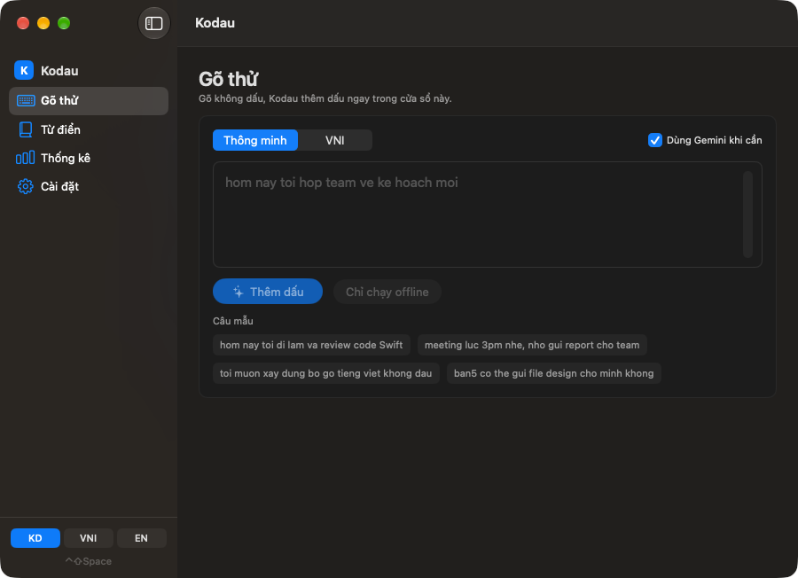
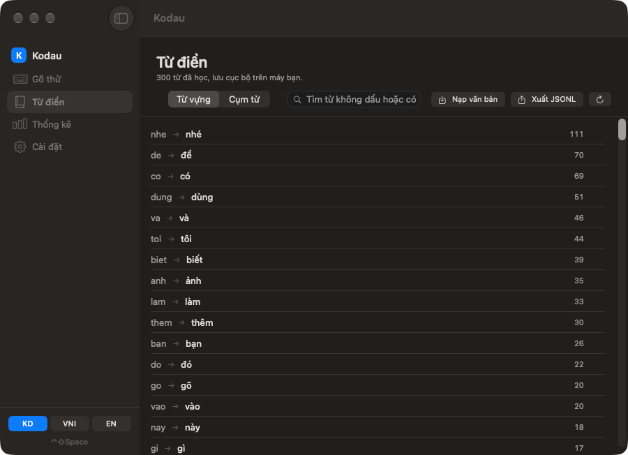
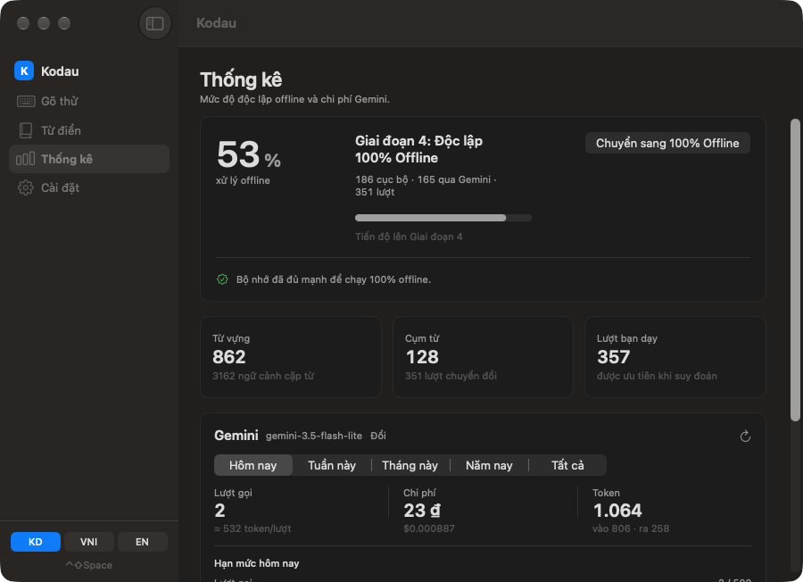
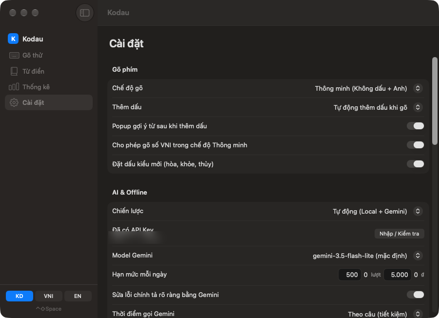

# Kodau — Bộ gõ Tiếng Việt Không Dấu + Tiếng Anh Tự Học (macOS)

**Kodau** là ứng dụng bộ gõ macOS giúp bạn gõ **tiếng Việt không dấu** và **tiếng Anh xen kẽ (code-switching)** một cách tự nhiên mà không cần chuyển đổi ngôn ngữ, hỗ trợ **VNI đầy đủ**, bảo vệ tuyệt đối **ô nhập mật khẩu macOS**, và tự học văn phong cá nhân theo lộ trình để đạt **100% Offline không cần gọi API**.

## Video giới thiệu

[](docs/media/kodau-promo.mp4)

*Bấm vào ảnh để xem video (46 giây): gõ không dấu → dấu tự hiện, tiếng Anh giữ nguyên, chọn từ khác bằng ⌥1…⌥5, và bảng điều khiển Kodau.*

## Ảnh chụp màn hình

| Gõ thử | Từ điển |
|---|---|
|  |  |
| **Thống kê** | **Cài đặt** |
|  |  |

## Tính năng nổi bật

1. **Chế độ Thông minh (Smart Mode — Không dấu + Tự nhận diện Anh/Việt)**
   - Gõ không dấu tiếng Việt (`hom nay toi di lam va review PR cho team`) → tự phục hồi thành `hôm nay tôi đi làm và review PR cho team`.
   - Gõ tiếng Anh hoàn chỉnh (`I want to ship this macOS app today`) → tự nhận diện tiếng Anh và giữ nguyên 100%.
   - **VNI ghi đè tức thì (Inline VNI Override)**: Ngay trong chế độ Không dấu, nếu gặp từ khó bạn vẫn có thể gõ VNI (`tie6ng1`, `ban5`, `d9uoc75`) → chuyển dấu ngay và dạy lại não cục bộ với độ ưu tiên cao nhất.
2. **Chế độ VNI chuẩn**
   - Đầy đủ dấu thanh (`1` sắc, `2` huyền, `3` hỏi, `4` ngã, `5` nặng, `0` xóa dấu), mũ/móc/trăng/đ (`6`, `7` tự ghép `uo7`→`ươ`, `8`, `9`), nhấn đúp để hoàn tác (`a11`→`a1`), đặt dấu kiểu mới/cũ (`hòa`/`hoà`).
   - Mọi từ gõ bằng VNI cũng tự động huấn luyện cho não Không dấu offline!
3. **Lộ trình tự học hướng tới 100% Offline**
   - Sử dụng **Gemini (`gemini-3.5-flash-lite` mặc định**, hỗ trợ chọn `gemini-2.5-flash-lite`, `gemini-2.5-flash`, `gemini-2.0-flash`, `gemini-1.5-flash` hoặc tên model tùy chỉnh) làm bộ não hỗ trợ giai đoạn đầu.
   - Tự động lưu Unigram, Bigram, Trigram, Cụm câu (Phrase Memory) và mọi lần bạn chỉnh sửa vào SQLite cục bộ (`~/Library/Application Support/Kodau/kodau_brain.sqlite`).
   - Hỗ trợ **dán bài viết Facebook / ghi chú / email** để học nhanh văn phong cá nhân (tự động lọc bỏ link, hashtag và dòng UI rác).
   - Hỗ trợ xuất dataset định dạng **JSONL** để fine-tune mô hình cục bộ về sau.
4. **An toàn tuyệt đối cho ô nhập mật khẩu trên macOS**
   - Tự động phát hiện **Secure Event Input** (`Carbon.IsSecureEventInputEnabled()`) và **AXSecureTextField** (Accessibility API).
   - Khi bạn focus vào ô mật khẩu: bộ nhớ đệm bị xóa sạch, toàn bộ phím đi thẳng vào ô mật khẩu không qua xử lý, **không lưu log, không gửi API**, biểu tượng thanh menu chuyển sang `🔒`, và tự phục hồi trơn tru ngay khi rời ô mật khẩu (không bao giờ bị treo hay khóa bộ gõ).

## Cách Kodau học (theo ngữ cảnh, không phải "thay thế")

Kodau không lưu luật kiểu "`ban` luôn là `bạn`". Mỗi lần học, nó ghi nhận **từ đó trong ngữ cảnh nào**:

| Ngữ cảnh | Ví dụ được ghi nhớ |
|---|---|
| Từ bên trái (bigram) | `chào` → `ban` = **bạn** |
| 2 từ bên trái (trigram) | `tôi muốn` → `ban` = **bán** |
| Từ bên phải (`next_bigrams`) | `ban` + `hàng` = **bán**, `ban` + `ơi` = **bạn** |
| Đầu câu (`<s>`) | `<s>` → `mo` = **Mô** |
| Cả cụm câu (phrase memory) | `chao ban nhe` → **chào bạn nhé** |

- **Lời sửa của bạn** (⌥1..5, gõ VNI xen kẽ, ⌥Esc, toast "Học từ này") được cộng điểm mạnh và gắn cờ *user-verified* trên các mục ngữ cảnh ở trên.
- **Unigram** (từ đứng một mình) chỉ là xác suất nền yếu, không bao giờ mang cờ ghi đè. Vì thế sửa `bàn` trong "cái bàn gỗ" không làm "chào bạn" thành "chào bàn".
- **Gemini**: mọi câu Gemini khôi phục được chưng cất vào đúng các bảng ngữ cảnh này, nên càng dùng thì càng ít phải gọi API.

## Phím tắt toàn hệ thống

- `Ctrl + Shift + Space`: Chuyển nhanh chế độ `Thông minh (KD) → VNI → Tiếng Anh (EN)`
- `Option + 1 ... 5`: Chọn nhanh phương án dấu khác trên thanh gợi ý (Candidate HUD) và dạy cho AI
- `Option + Esc`: Hoàn tác lần chuyển dấu gần nhất (giữ nguyên chữ gốc/tiếng Anh và dạy cho AI)

## Build & Chạy ứng dụng

```bash
make signing   # 1 lần duy nhất: tạo chứng chỉ ký cục bộ để macOS giữ quyền Trợ năng qua các lần build
make test      # chạy unit test (tự dùng Xcode nếu có — CommandLineTools thiếu module Testing)
make install   # build + cài bộ gõ KodauIM vào ~/Library/Input Methods và đóng gói build/Kodau.app
open build/Kodau.app
```

Checklist chạy thử trên máy thật: [docs/TEST_CHECKLIST.md](docs/TEST_CHECKLIST.md).

## Bật bộ gõ Kodau (đường gõ chính)

1. `make install` để cài bộ gõ **KodauIM** vào `~/Library/Input Methods`.
2. **System Settings → Keyboard → Input Sources → Edit… → + → Tiếng Việt → "Kodau (Smart Vi/En)" → Add**.
3. Chọn Kodau trên menu nguồn nhập liệu (hoặc bấm **"Chọn Kodau ngay"** trên Dashboard).
   Không cần quyền Trợ năng; macOS tự tắt bộ gõ trong ô mật khẩu.
4. Lần đầu mở `Kodau.app` (Dashboard), dán Gemini API Key và bấm **Kiểm tra kết nối**.

**Chế độ cũ (tuỳ chọn):** Cài đặt → *Đường gõ* → "Chế độ cũ: chặn phím toàn hệ thống". Chế độ này cần quyền Trợ năng và
sửa chữ bằng phím Backspace giả lập — chỉ dùng cho app mà bộ gõ không hoạt động tốt.
